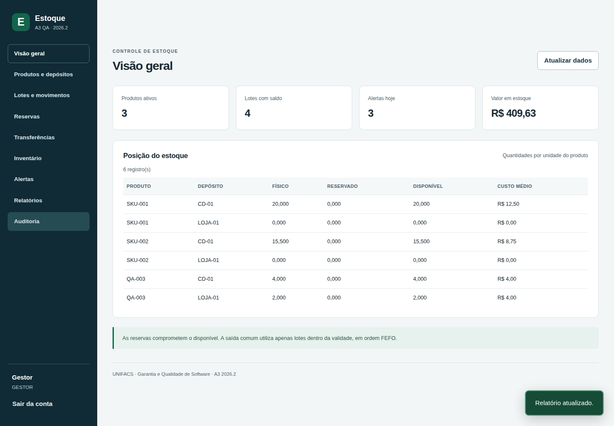

# Relatório de execução — Controle de Estoque

## Identificação e método

- Referência: ERS Controle de Estoque 1.0, emitida em 20/09/2026, 34 páginas.
- Versão de partida: commit `ee691c9b56f846a4ad40412c07eb4073b41062b7` do repositório acadêmico.
- Versão implementada: 2.0.0, código desta entrega.
- Execução observada: 16/11/2026, conforme o horário registrado no log Maven (America/Bahia).
- Ambiente: Linux, OpenJDK 17, Apache Maven 3.9.9, JUnit Jupiter 5.11.0, Surefire 3.5.2 e JaCoCo 0.8.12.
- Comando de reprodução no projeto: `./mvnw -B -ntp clean verify` ou `.\mvnw.cmd -B -ntp clean verify`.
- Neste ambiente foi usado um espelho temporário local para resolver dependências. Isso não altera os testes; os scripts de espelho não fazem parte do projeto.
- Os testes isolam banco e relógio. O benchmark identifica separadamente suas condições de carga.

## Resultado observado

**181 testes executados, zero falhas, zero erros, zero ignorados. BUILD SUCCESS.**

| Suíte | Testes | Falhas | Erros | Ignorados |
| --- | --- | --- | --- | --- |
| ConcorrenciaTest | 5 | 0 | 0 | 0 |
| CriteriosAceitacaoTest | 24 | 0 | 0 | 0 |
| DesempenhoTest | 1 | 0 | 0 | 0 |
| InventarioTest | 31 | 0 | 0 | 0 |
| PersistenciaTest | 4 | 0 | 0 | 0 |
| RegrasNegocioTest | 86 | 0 | 0 | 0 |
| ServicoEstoqueTest | 15 | 0 | 0 | 0 |
| ServidorHttpTest | 15 | 0 | 0 | 0 |

O total conta individualmente as invocações parametrizadas. O [log Maven](evidencias/maven-verify.txt) e o [resumo extraído do Surefire](evidencias/resumo-junit.json) sustentam o resultado. Os XML completos são regenerados em `target/surefire-reports/`.

Cobertura JaCoCo observada: **86.1% de linhas**, **68.0% de ramos** e **85.0% de instruções**, considerando todas as classes da aplicação. Cobertura de código não equivale a conformidade integral. O HTML completo é gerado em `target/site/jacoco/index.html`; os contadores desta execução estão em [cobertura-resumo.json](evidencias/cobertura-resumo.json).

## Histórico dos defeitos

A primeira execução histórica tinha 11 aprovações e quatro ocorrências em CT011, CT013, CT014 e CT015. A correção anterior passou os 15 casos, mas ainda deixava requisitos sem cobertura. A comparação com o PDF encontrou outras divergências, reproduzidas na versão de partida e preservadas em [contraexemplos-versao-inicial.txt](evidencias/contraexemplos-versao-inicial.txt).

| Defeito reproduzido na versão de partida | Correção e regressão |
| --- | --- |
| Saída de 7,001 com físico 10 e reservado 3 deixava disponível −0,001 | Saída usa disponível; CA-008 rejeita sem debitar lotes |
| Lote que venceu após a entrada saía normalmente | FEFO filtra validade na data da saída; CA-011 |
| SKU-001 e sku-001 eram dois produtos | Normalização antes de validar unicidade; CA-004/005 |
| Mesma chave com quantidade diferente retornava operação anterior sem conflito | Conteúdo canônico comparado; CA-019 |
| Falha simulada no crédito deixava a origem debitada | Transação única, rollback de dados, movimentos e chaves; CA-017 |
| Disponível igual ao mínimo não alertava | Comparação inclusiva; CA-022 |
| Vencimento em 30 dias era excluído | Janela inclusiva até o trigésimo dia; CA-023 |
| Reserva com expiração passada era aceita | Validação de futuro; testes UC-05 e HTTP 422 |
| Reserva expirada podia mudar para cancelada | Estados terminais protegidos; RN011_estadoExpiradoTerminal |
| Quantidade, custo e data fora dos limites eram aceitos | Validações nos limites e testes parametrizados |

Também foram implementados atendimento de reservas, alterações de produto com histórico, ajustes autorizados, inventário, movimentos, relatórios, auditoria, permissões, persistência de idempotência e interface local.

## CT001–CT015: entradas e resultados

| CT | Preparação / entrada | Esperado e observado nas asserções | Situação |
| --- | --- | --- | --- |
| CT001 | SKU-001, Cabo de rede, UN, mínimo 5,000 | Produto persistido com SKU e nome informados | Aprovado |
| CT002 | SKU !@# | IllegalArgumentException, SKU inválido; nenhum produto cadastrado | Aprovado |
| CT003 | Código cd-01 e nome do centro | Código CD-01 normalizado e depósito persistido | Aprovado |
| CT004 | Código vazio | IllegalArgumentException, Código inválido; nenhum depósito cadastrado | Aprovado |
| CT005 | Entrada de 20,000 a R$ 12,50, validade futura | Um lote; físico 20,000 | Aprovado |
| CT006 | Entrada com validade de ontem | Lote vencido rejeitado; nenhum lote persistido | Aprovado |
| CT007 | Lotes de 10,000 e 15,000; sem reserva | Físico e disponível 25,000 | Aprovado |
| CT008 | Físico 20,000; reservar 5,000 para amanhã | ATIVA; físico 20,000; disponível 15,000 | Aprovado |
| CT009 | Físico 10,000; reservar 15,000 | Saldo disponível insuficiente; nenhuma reserva criada | Aprovado |
| CT010 | Reserva expira em T+1 s; avançar relógio para T+2 s | Estado EXPIRADA | Aprovado |
| CT011 | Primeiro B com validade +25 dias; depois A com +5; saída 5,000 | A=0,000 e B=5,000 | Aprovado |
| CT012 | Físico 10,000; saída 15,000 | Saldo insuficiente; físico permanece 10,000 | Aprovado |
| CT013 | Origem 10,000; transferir 5,000 para CD-02 | Origem 5,000; destino 5,000 | Aprovado |
| CT014 | Repetir chave válida e mesmos dados da transferência | Mesmo resultado; saldos 5,000 e 5,000; um registro | Aprovado |
| CT015 | 10,000 a R$ 10,00 e 30,000 a R$ 20,00 | Média ponderada R$ 17,50 | Aprovado |

CT010 foi ajustado para criar uma reserva futura e avançar o relógio, respeitando UC-05. CT011 passou a cadastrar primeiro o lote que vence depois. As chaves de CT013/CT014 foram adequadas ao mínimo de 16 caracteres. Os resultados esperados de negócio foram preservados.

## CA-001–CA-024: complemento do PDF

| CA | Entrada / ação | Resultado observado nas asserções |
| --- | --- | --- |
| 001 | Entrada de 0,001 | Aceita; físico 0,001 |
| 002 | Entrada zero | Rejeitada; nenhum lote |
| 003 | Entrada de 1,0001 | Rejeitada; nenhum lote |
| 004 | SKU minúsculo com espaços externos | SKU-002 normalizado |
| 005 | Cadastrar SKU equivalente ao existente | Rejeitado; um produto |
| 006 | Físico 10 e reserva 3 | Reservado 3; disponível 7 |
| 007 | Saída de 7 com disponível 7 | Físico 3; disponível zero |
| 008 | Saída de 7,001 com disponível 7 | Rejeitada; físico 10 e disponível 7 preservados |
| 009 | Duas validades, entrada em ordem inversa ao FEFO | Lote de validade mais próxima consumido |
| 010 | Mesma validade; entradas com diferença de 1 s | Lote recebido primeiro consumido |
| 011 | Lote vence após a entrada; tentar saída | Rejeitada; saldo 10 preservado |
| 012 | Reservar as 10 unidades disponíveis | Disponível zero; físico 10 |
| 013 | Reservar 10,001 com disponível 10 | Rejeitada; nenhuma reserva |
| 014 | Avançar ao instante exato de expiração | EXPIRADA; disponível volta a 10 |
| 015 | Cancelar duas vezes a reserva de 3 | Disponível 10; reservado zero |
| 016 | Transferir 4 de um total de 10 | Soma dos depósitos permanece 10 |
| 017 | Falhar uma confirmação persistente após preparar transferência | Origem 10, destino zero e movimentos anteriores preservados; retry válido funciona |
| 018 | Repetir transferência equivalente | Mesmo resultado; débito único |
| 019 | Repetir chave mudando quantidade | Conflito; saldos anteriores preservados |
| 020 | Contar zero para lote com referência 10 | Zero aceito e conciliado |
| 021 | Concluir duas vezes a mesma conciliação de 10 para 8 | Um ajuste; saldo 8 |
| 022 | Disponível 5 e mínimo 5 | Alerta de reposição gerado |
| 023 | Lote vence em 30 dias exatos | Lote incluído e alerta gerado |
| 024 | Registros exatamente no início e no fim | Ambos incluídos; intervalo invertido rejeitado |

Todos os 24 casos foram aprovados na execução registrada. A [matriz](MATRIZ_RASTREABILIDADE.md) relaciona os complementos aos demais RF/RN.

## Concorrência, recuperação e desempenho

Saídas simultâneas de 24 participantes disputaram dez unidades: dez saídas foram aceitas e o saldo terminou em zero. Vinte reservas simultâneas também respeitaram o físico. Dezesseis transferências concorrentes com a mesma chave produziram uma única transferência. O reinício conservou estoque, auditoria e idempotência. O teste de retenção avançou o relógio mais de cinco anos e recuperou o histórico.

Medição observada, com 100 mil lotes, aquecimento e vinte amostras por operação:

```text
100000 lotes; 20 amostras por operação; P95 pelo posto ceil(0.95*N).
Consulta P95 (ms): 30.490572
Movimentação P95 (ms): 239.729059
Armazenamento em memória; sem rede e sem persistência em disco.
```

Os limites de aceitação são P95 ≤ 2.000 ms para consulta e ≤ 1.000 ms para movimentação. A medição não inclui disco/rede e não substitui um teste do ambiente operacional.

## Interface e limites da conclusão

Os quinze testes HTTP verificam sessão, permissões, CSRF, resposta de conflito/validação, precisão decimal, JSON inválido, logout, atendimento de reserva e arquivos web servidos. O JAR executável também foi exercitado no modo `--demo`; a [saída observada](evidencias/demonstracao-terminal.txt) corresponde ao [roteiro](COMO_APRESENTAR.md).

O roteiro de navegador foi executado na integração contínua: **Chromium 151.0.7922.34 e Firefox 153.0**, ambos aprovados, com dez fluxos e quinze verificações de tela/estado por navegador, sem violações detectadas pelo axe nas regras WCAG selecionadas. Isso inclui login, produto, entrada decimal, reserva, atendimento, transferência, inventário, CSV, rolagem por teclado e consulta de auditor.

A primeira execução web identificou `scrollable-region-focusable` na tabela móvel. A correção tornou a região alcançável pelo teclado, nomeou a região e acrescentou foco visível. A reexecução passou nos dois navegadores. Os resultados estruturados estão em [interface-chromium.json](evidencias/interface-chromium.json) e [interface-firefox.json](evidencias/interface-firefox.json).

A [execução de CI observada](https://github.com/joaorizzo0112/A3_QA_ControleEstoque_2026.2/actions/runs/43924233298) também aprovou Java 17/21 em Linux/Windows. Essa execução corresponde ao commit `3fe53222000842dadeb3ea9f7a87b9aee3d32446`, anterior apenas à ampliação adicional dos testes de limites e transições para 181 casos; os arquivos da aplicação são os mesmos. O resultado mais recente da branch está disponível no PR.



A inspeção automática não substitui avaliação humana WCAG. A revisão das imagens confirmou o painel no desktop e no celular, com rolagem da tabela contida na própria região.

Acessibilidade WCAG integral, duas versões estáveis de cada navegador e disponibilidade mensal exigem as validações externas descritas em [Decisões e validações](DECISOES_E_VALIDACOES.md). O parâmetro de limite de depósitos existe e está testado; o número contratual não é informado no PDF.
